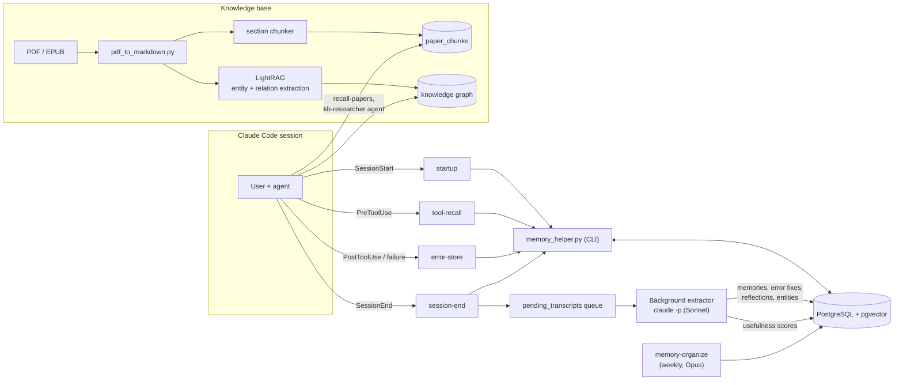

# Agentic GraphRAG Memory

Long-term memory and a research knowledge base for an AI coding agent ([Claude Code](https://docs.anthropic.com/en/docs/claude-code)), built on PostgreSQL + pgvector, an entity–relationship graph, and a [LightRAG](https://github.com/HKUDS/LightRAG) knowledge graph.

> **Status:** a personal system I designed and run every day on my own workstation (Windows, Postgres 18) since February 2026. This repository is the code. The database contents, the document library, the knowledge-graph files and the logs are not included.

## The problem

A coding agent starts every session with no memory. It repeats mistakes it has already fixed, rediscovers workarounds, forgets decisions and preferences, and can't draw on the papers and books its user has read. Pasting notes into a prompt doesn't scale, and "remember everything" quickly fills the context with noise.

This system gives the agent four things:

1. **Distilled memory.** Each session is turned into short, durable memories (facts, decisions, bug fixes, preferences, patterns) by a background LLM pass with explicit quality gates.
2. **Just-in-time recall.** Relevant memories and known error fixes are injected into the agent's context at the moment they matter: at session start, before a tool runs, and on request.
3. **A research library.** PDFs and EPUBs become a searchable RAG corpus and a knowledge graph of methods, models, datasets and concepts.
4. **Feedback.** Every injection is logged and later scored as useful or not, so retrieval quality is measured instead of assumed.

## In numbers

From the live database on 19 October 2026:

| | Count |
|---|---:|
| Memories (since 14 Feb 2026) | 1,676 |
| Sessions recorded | 1,315 |
| Error → solution pairs | 618 |
| Reflections | 565 |
| Graph entities / relationships | 1,723 / 1,289 |
| Logged memory injections ("exposures") | 10,790 |
| Papers and books in the library | 261 |
| Searchable chunks | 23,140 |
| **Average usefulness of injected memories** (748 scored memories) | **21.6%** |

The last row is the honest headline: most injected memories are judged not useful in the session where they appear. Raising that number is the main open problem (see [Limitations](#limitations-and-open-problems)).

## Architecture



Everything lives in one PostgreSQL database: memories, vectors, the entity graph, the work queue and the evaluation logs. One transactional store keeps joins between memories, entities, sessions and exposures simple, and avoids running a separate vector database.

## How a memory moves through the system

### 1. Capture: Claude Code hooks

Hooks are small commands Claude Code runs at fixed points. They are kept fast and mostly write-only, so the agent never waits on an LLM call.

| Hook | Command | What it does |
|---|---|---|
| `SessionStart` | `startup` | Registers the new session (the database row is written on the first prompt), closes orphaned sessions from the same project and queues their transcripts for extraction, and records a transcript baseline for checkpointing. Works even if the database is down. |
| `PreToolUse` | `tool-recall` | Before a tool runs, injects notes and known error → fix pairs for that tool. In my setup it is matched to web fetches, where known failures are most common; the matcher can cover any tool. Example of what the agent sees before a web fetch: *"Tool notes for WebFetch: [err:114] Request failed with status code 403: Use Chrome MCP…"* |
| `PostToolUse`, `PostToolUseFailure` | `error-store` | Records errors from shell, file-edit, sub-agent, web and MCP tools into `error_solutions` so fixes can be attached later. |
| `SessionEnd` | `session-end` | Saves the session, stores the filtered transcript in `pending_transcripts`, and spawns the background extractor. |
| `UserPromptSubmit` | `turn-recall` | Per-prompt retrieval (below). On a session's first prompt it also injects project context and a handoff from the previous session. Included in `settings.example.json`; switched off in my own configuration. |
| `Stop`, `SubagentStart/Stop`, `PreCompact` | `tracer/trace_hook.py` | Emits trace events for the live dashboard. |

### 2. Distil: background extraction

`session-end` launches `claude -p` (Sonnet) as a background process that works through the transcript queue. Its prompt (`_build_sonnet_prompt` in `memory_helper.py`) enforces:

- **Two quality gates** for every candidate. *Discoverable?* If a fresh agent could learn it by reading the code, config or `--help`, skip it. *Novel and actionable?* If knowing it wouldn't change what an agent does, skip it.
- **Category templates**, for example a bug memory must read "When [X], expect [Y] but actually [Z]. Fix: [workaround]."
- **Banned "changelog verbs"** ("Added", "Implemented", "Fixed" …): a memory must state what is true now, not narrate what was done.

A supplementary pass extracts **entities, relationships and project artefacts** into the graph tables.

**Usefulness scoring.** `get-exposures`, `score-exposure` and `batch-score-exposures` record whether each memory injected in a session was actually useful, and update that memory's `useful_pct`. 748 memories have scores. In the current code these commands aren't part of the automatic extraction prompt, so scoring happens only when they are run.

### 3. Store: schema

`sql/schema_full.sql` is a schema-only dump of the live database: 22 tables, with the `vector` and `pg_trgm` extensions. The core tables:

| Table | Holds |
|---|---|
| `memories` | The distilled memories: category, domain, importance (1–10), 512-dim embedding, project, usefulness statistics |
| `error_solutions` | Error signatures with their fixes, recalled before tool calls |
| `reflections`, `lessons_learned` | Post-task reflections and lessons promoted from them |
| `entities`, `relationships`, `entity_mentions` | The knowledge graph over memories |
| `sessions`, `pending_transcripts` | Session records and the extraction work queue |
| `memory_exposures` | Every injection, with whether it turned out to be useful |
| `papers`, `paper_chunks` | The document library and its embedded chunks |
| `projects`, `project_artifacts`, `agents` | Scoping and provenance |

`sql/schema.sql` and `sql/migrations/` (with rollback scripts) are kept for history. The live schema also changed outside those files, so treat `schema_full.sql` as the source of truth.

### 4. Retrieve

`turn-recall` runs this pipeline (`cmd_turn_recall`). The explicit `recall` command is a simpler combined vector and full-text search.

1. **Embed** the query with model2vec `potion-base-32M` (512-dim, under 1 ms on CPU).
2. **Vector search**, scoped and filtered: HNSW cosine index, top 10, keep similarity > 0.45. Only the current project, untagged memories, or critical ones (importance ≥ 9). Skips anything already shown in this session.
3. **Seeded graph walk**: from those hits, one hop through `entities` / `relationships` to pull in connected memories.
4. **Rerank** each candidate:

   ```
   score = 0.50 · relevance
         + 0.15 · recency          (exponential decay, 30-day half-life)
         + 0.35 · importance / 10
         + 0.10 if same project
         + 0.05 if reached through the graph
   ```

   Memories with importance 8 or higher skip the recency decay.

5. **Diversify** with Maximal Marginal Relevance (λ = 0.7): pick 3 memories that are relevant but not near-duplicates of each other.
6. **Log** each injection to `memory_exposures`, with a cooldown so the same memory isn't injected again and again.

### 5. Feedback and maintenance

- **Exposure scoring** (above) gives every memory a usefulness rate.
- **`memory-organize`** is a weekly maintenance agent (Opus). It merges duplicates, flags contradictions, marks superseded memories and decays stale ones.
- **`audit-memories`**, **`cleanup`**, **`promote-lessons`** and **`backfill-embeddings`** handle housekeeping.

## Knowledge base: RAG and GraphRAG

### Ingestion

1. **Convert**: `tools/pdf_to_markdown.py` turns PDFs, EPUBs and URLs into markdown with PyMuPDF4LLM, with optional Tesseract OCR for scanned documents (`--ocr`).
2. **Chunk**: `chunk_markdown_by_section` splits on `##` headings, with at most 2,000 characters of body text per chunk. Longer sections fall back to paragraph, then sentence boundaries. Every chunk is prefixed with its paper title and section heading, so it carries context when retrieved alone.
3. **Embed and store** in `paper_chunks` with the same 512-dim model as memory recall and an HNSW cosine index (`ingest-paper`).

### Retrieval

- `recall-papers` runs semantic search over the chunks, optionally combined with a knowledge-graph query.
- The **`kb-researcher` agent** (`claude-code/agents/kb-researcher.md`) does agentic retrieval. It classifies the question, reformulates it when results are weak, follows multi-hop chains, and answers with citations.

### LightRAG knowledge graph (`lightrag_kb.py`)

A second index extracts entities and relations from the same library into a graph, so the agent can ask relationship questions ("which methods were evaluated on which datasets?") that plain vector search answers poorly.

| Component | Choice |
|---|---|
| Storage | LightRAG's Postgres KV, vector and document-status stores, plus a NetworkX graph file |
| Embeddings | EmbeddingGemma-300M (ONNX, fp32, 768-dim) |
| Extraction LLM | Gemini 2.5 Flash-Lite, with Claude Haiku as fallback |
| Entity types | 10 domain types: Method, Framework, Model, Concept, Person, Organization, Metric, Dataset, Tool, Task |
| Prompting | Replaced LightRAG's default few-shot examples (fiction, sports) with three academic-paper examples |

Bulk ingestion of the whole library surfaced failure modes in the library itself. They are fixed with targeted patches:

| Fix | Problem it solves |
|---|---|
| Atomic, XML-safe graph writes | Invalid characters crashed the graphml writer on Windows; a killed process could corrupt the file |
| Entity-name normalisation | "AI Agent" and "AI Agents" became separate nodes |
| Short or junk entity filter | Math symbols (α, μ, d) and bare numbers were extracted as entities |
| Entity-type constraint | The LLM invented types outside the 10 defined |
| Capped description lists | Merging very common entities overflowed the LLM context |
| Self-loop removal and lock-key de-duplication | Self-referencing relations and duplicate locks |
| Fault-tolerant merging (tried, then disabled) | LightRAG cancels a whole document when one entity fails. A patch replacing `asyncio.wait` globally survived that but caused deadlocks, so it is switched off |

`run_bulk_ingest.py` runs the ingestion, `ingest_watchdog.py` detects deadlocks and restarts it, and `check_ingest_status.py` reports progress. See `docs/lightrag-tuning.md` for the tuning log.

## Design decisions

**Two embedding models.** Memory recall runs inside hooks, so it has to be close to free, and the paper chunks use the same fast model. The LightRAG graph is built offline and benefits from a stronger model. Measured on my hardware (`docs/embedding-benchmarks.md`):

| Model | Dims | MTEB retrieval | CPU latency | Used for |
|---|---:|---:|---:|---|
| model2vec potion-base-32M | 512 | 33 | < 1 ms | Memory recall, paper chunks |
| EmbeddingGemma-300M | 768 | ~59 | ~20 ms (fp32) | LightRAG knowledge graph |

The quantised ONNX build of EmbeddingGemma was about 10× *slower* than fp32 for single queries, so fp32 is used.

**Fast hooks, slow work in the background.** Hooks only read or write the database. All LLM work (extraction, scoring, organising) runs out of band, so memory never makes the agent slower.

**Quality gates over volume.** The extraction prompt rejects memories that are neither findable nor actionable, which keeps the store small enough to stay relevant.

**Measure usefulness.** Logging every exposure and scoring it afterwards turns "is the memory helping?" into a number that can be tracked.

## Limitations and open problems

- **Low retrieval precision.** An average usefulness of 21.6% means most injected memories are noise for the task at hand. Next steps: a held-out evaluation set (hit@k on real past questions), a stronger embedding model for recall now that latency is measured, and using `useful_pct` directly in ranking.
- **Unattended LLM runs with permission prompts off.** The background extractor runs `claude -p` with `--dangerously-skip-permissions`, `--allowedTools Bash`, no MCP servers and a $5 budget cap. It only processes local transcripts with fixed prompts, but Bash is still broad. The fix is to allow only the memory CLI commands it needs, so a prompt injection hidden in a transcript can't run arbitrary shell commands.
- **Fixed while preparing this release:** the project lookup in `turn-recall` used an unescaped `%` in a parameterised SQL query. The query failed silently, so recall was never scoped to the current project and the same-project boost never applied. It now uses `%%`.
- **Monolith, no test suite.** `memory_helper.py` is about 6,200 lines and has no automated tests in this repository. It should be split into capture, extraction, retrieval and maintenance modules.
- **Windows-first.** Process handling and some defaults assume Windows.
- **Schema drift.** Migrations didn't capture every change, hence the `schema_full.sql` dump.
- **Domain tables.** `backtest_results`, `strategies` and `strategy_evolution` come from the quantitative-research work this system was built alongside. The core memory loop doesn't use them.
- **Library internals.** The LightRAG fixes patch private functions, so the version is pinned (`lightrag-hku==1.4.12`).

## Repository layout

```
memory_helper.py          CLI used by all hooks: capture, extraction queue, recall, scoring, maintenance
lightrag_kb.py            LightRAG configuration, patches and query interface
run_bulk_ingest.py        bulk LightRAG ingestion runner
ingest_watchdog.py        deadlock detection and auto-restart for bulk ingestion
check_ingest_status.py    ingestion progress report
batch_rewrite.py          batch rewrite of existing memories through the quality gates
seed_error_solutions.py   seeds error_solutions from existing bug memories
dashboard.py              Streamlit explorer for the database
tracer/                   live trace dashboard for sessions and subagents, plus knowledge-graph view
tools/pdf_to_markdown.py  PDF / EPUB / URL to markdown converter (optional OCR)
sql/schema_full.sql       schema-only dump of the live database (source of truth)
sql/schema.sql, migrations/   original schema and migrations with rollbacks
claude-code/              skills (ingest, recall-papers, remember), the kb-researcher agent, example hook settings
docs/                     embedding benchmarks, LightRAG tuning log
```

## Setup

The code reflects my own environment and isn't packaged as a library. To run it:

1. Install PostgreSQL 16+ with the `vector` (pgvector) and `pg_trgm` extensions. Create a database, load the schema, and register an agent identity:
   ```bash
   psql -d agent_memory -f sql/schema_full.sql
   psql -d agent_memory -c "INSERT INTO agents (agent_id, display_name, agent_type, environment) VALUES ('my-agent', 'Claude Code', 'claude-code', 'local');"
   ```
2. `pip install -r requirements.txt`
3. Set the environment variables in `.env.example`. `AGENT_MEMORY_DB_URI` and `AGENT_ID` are required; LLM keys are needed only for the knowledge graph.
4. Put this repository at `~/.claude/memory/`, which is where the hook commands expect it. Copy `claude-code/skills/*` into `~/.claude/skills/` and `claude-code/agents/*` into `~/.claude/agents/`, then merge `claude-code/settings.example.json` into `~/.claude/settings.json`.
5. Try it: `python memory_helper.py store-memory --content "..." --category fact`, then `python memory_helper.py recall --query "..."`.

## How this was built

I designed, operate and evaluate this system. Much of the code was written with Claude Code as a pair programmer, under the same review-and-verify workflow the system itself supports.
